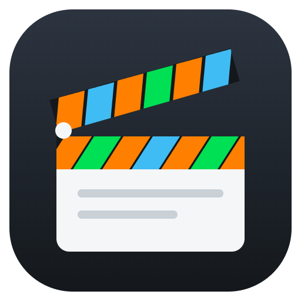

<p align="center">
  
</p>

<h1 align="center">NANDFlix</h1>

<p align="center">
  Sua lista de filmes com cara de streaming: capas, trailers tocando ao fundo, sorteio do que assistir
  e um clique para abrir o filme no <b>Stremio</b> ou registrar no <b>Letterboxd</b>.
</p>

---

O NANDFlix é um app de desktop para catalogar os filmes que você quer ver. Ele troca a planilha por uma interface no estilo Netflix: o filme sorteado ocupa o topo com o trailer rodando, as capas viram trailers ao passar o mouse e cada filme tem uma página de detalhes com logo, notas, sinopse, elenco e duração. Na hora de assistir, ele abre o filme direto no Stremio. Ele também guarda o que você viu num calendário, deixa você dar notas, montar uma tierlist e ver as suas estatísticas.

## Download

| Arquivo | O que é |
|---|---|
| [`NANDFlix.exe`](NANDFlix.exe) | Versão portátil para Windows: é só abrir, não precisa instalar. |
| [`dist/NANDFlix-Setup-1.0.6.exe`](dist/NANDFlix-Setup-1.0.6.exe) | Instalador para Windows (cria atalho no menu Iniciar). |
| [`dist/NANDFlix-1.0.6-portable.exe`](dist/NANDFlix-1.0.6-portable.exe) | O mesmo portátil da raiz, com o número da versão. |

Os mesmos arquivos estão na página de [Releases](../../releases).

> O executável não é assinado digitalmente, então o Windows pode mostrar o aviso do SmartScreen na primeira vez. Clique em **Mais informações → Executar assim mesmo**.

## Funcionalidades

### Filme sorteado (topo da tela)
- O app já abre com um filme sorteado entre os que você ainda não viu.
- O trailer toca ao fundo, sem som, com botão para ligar o áudio.
- Capa pequena com a **logo do filme** no lugar do título (como na Netflix), gênero, ano, duração e classificação indicativa, notas do IMDb, Metascore e Rotten Tomatoes, sinopse e botões: **Assistir**, **Mais info**, **Sortear outro**, **Marcar como visto** e **Letterboxd**.
- Os sorteios ficam num carrossel: dá para voltar aos anteriores pelas setas ou pelos pontinhos.
- O sorteio respeita o que está na tela: filtro de favoritos, busca e filtro por diretor.
- **Sortear com filtro**: ao passar o mouse no dado do topo, aparece o botão para sortear só entre os filmes de até 1h30, 1h40, 2h ou 2h30, de certos gêneros, décadas ou países, ou só entre os da watchlist de hoje. A janela mostra quantos filmes podem sair, e os filtros ficam salvos. Com filtro ligado, o dado ganha um ponto roxo.
- Clicar no trailer abre o **modo foco**: o vídeo ocupa quase a tela toda, com som e controles, continuando do ponto em que estava.

### Prévia ao passar o mouse
- Depois de 1 segundo sobre uma capa, ela cresce e vira o trailer, como na Netflix.
- A prévia traz botões para assistir, marcar visto, favoritar, abrir no Letterboxd e ver detalhes, além de ano, duração, gêneros e notas.
- Passar pelos botões redondos de cima da capa não dispara o trailer.
- A lixeira da prévia tira o filme da lista na hora, com **Desfazer** no aviso.

### Página de detalhes
- Janela centralizada, com o trailer tocando atrás da capa e do título.
- Logo do filme, ano, duração, classificação indicativa, notas, sinopse, direção, elenco e gêneros.
- **Sua nota**: de ½ a 5 estrelas, dada nos detalhes; aparece também na tierlist e na página do dia do calendário.
- **Outros filmes do diretor** e **Mais como este**: fileiras de capas (com setas nos lados) mostrando o que já está na sua lista e o que você já viu, com **+** para adicionar o que falta.
- Clicar num filme que não está na lista abre os detalhes dele mesmo assim (logo, trailer, sinopse, elenco e os relacionados dele), com **Adicionar à lista** e um botão para voltar ao filme de onde você veio.
- **Remover da lista**, com **Desfazer** no aviso.
- Campos editáveis: título, ano, diretor, notas pessoais, link do Letterboxd, busca da capa e link do trailer (para trocar o que foi achado automaticamente).
- A partir do diretor: ver os filmes dele na sua lista ou abrir a página dele no Letterboxd.
- **Trocar capa**: escolher outra capa do mesmo filme no TMDB, buscar o filme certo (se o achado foi outro) ou usar uma imagem sua (também dá para arrastar a imagem para cima da capa).

### Listas
- **Filmes na sua lista**: fileira com os favoritos, rolagem suave pelas setas, trackpad ou Shift + roda do mouse, e a contagem de quantos você já viu.
- **Todos os filmes**: grade de capas ou lista compacta, filtros (todos, não vistos, vistos, favoritos), ordenação (ordem original, título, ano, diretor, país, adicionados recentemente) e o progresso de vistos.
- **Agrupar por diretor ou por país**: ordenando por um deles, a lista se separa em grupos com o nome e a quantidade de filmes (ex.: "Brasil · 6 filmes"). Cada filme entra no grupo do seu país principal; os países aparecem em português.
- **Filtrar por diretor ou país**: clicando no nome do grupo, ou no diretor e nos países da página de detalhes. Uma etiqueta mostra o filtro ativo e tira o filtro com um clique.
- Busca por título, ano, diretor, país ou notas, sem diferenciar acentos.

### Calendário
Um diário dos filmes que você vê e um planejador do que vai ver, aberto pelo botão de calendário no topo, ao lado da busca.

- **O que você viu, dia a dia**: o mês atual abre com o dia de hoje destacado, e cada dia em que você viu um filme vira um pequeno pôster, com as capas por cima da capa desfocada. As setas trocam de mês (com uma transição deslizando de um mês para o outro).
- Marcar um filme como visto já registra o dia. Para rever, use **Vi de novo hoje** nos detalhes: o filme aparece em todos os dias em que foi visto. Esqueceu de marcar? **Lançar outro dia** escolhe a data, e cada data pode ser apagada.
- **Pensando em ver hoje**: separe os filmes que você está considerando pelo botão de calendário na capa, na prévia ou nos detalhes. Eles ganham um selo roxo e aparecem no dia de hoje; ao marcar um como visto, ele passa para os vistos do dia. A watchlist é do dia: quando o dia vira, ela some.
- **Sortear um filme**: na página de hoje, as capas passam rápido até parar num filme não visto, que entra na watchlist de hoje (com opção de desfazer).
- **Página do dia**: clique num dia para ver as capas grandes, com os vistos centralizados e a watchlist com Assistir, marcar visto ou tirar da lista.
- **Planeje arrastando**: arraste a capa de um filme da watchlist para outro dia. Hoje ou depois, ele vai para a watchlist daquele dia; antes de hoje, fica registrado como visto nele. Segure sobre as setas ‹ › para trocar de mês sem soltar. Sem arrastar: **Passar para amanhã** e **Trazer para hoje** na página do dia.
- **Filme do mês**: escolha o seu favorito entre os filmes vistos em cada mês, pelo botão dourado no topo do mês ou por **Marcar como filme do mês** na página do dia. Ele aparece no topo com um troféu, e a capa dele vai para a frente no dia em que foi visto, com aro dourado.
- **Sortear com filtro** na página de hoje: a roleta de capas só com os filmes que passam nos filtros do sorteio, entre os que estão fora da watchlist (o escolhido entra nela) ou entre os que já estão nela (o escolhido vai para o primeiro lugar).
- Na página de um dia, a watchlist mostra cinco filmes por linha, e **arrastar uma capa muda a ordem** deles.
- Na página de um dia, os filmes vistos mostram a sua nota.
- O calendário começa no mês do filme visto mais antigo (inclusive as datas importadas do Letterboxd).
- O dia vira às 5h da manhã: um filme visto de madrugada conta para a noite anterior.
- Respeita o "reduzir movimento" do sistema: com os efeitos de animação desligados no Windows, o calendário não anima.

### Tierlist
Uma tierlist dos filmes que você já viu, aberta pelo botão de medalha ao lado do calendário.

- **Várias tierlists**: o título abre o menu para trocar de tierlist, criar uma nova, renomear (ex.: "Terror", "Melhores de 2026") ou apagar.
- **Filtros** por gênero, diretor, país, década e mês em que você viu, salvos em cada tierlist. Reorganizar os filmes visíveis não mexe na posição dos que o filtro esconde.
- Começa com as tiers **S, A, B, C, D e F**; os filmes vistos que ainda não estão em nenhuma ficam na bandeja **Sem tier**, embaixo, com um campo para filtrar.
- **Arraste as capas** para as tiers, entre elas ou de volta para a bandeja. As outras capas abrem espaço deslizando, e a ordem dentro de cada tier fica salva.
- **Clique no nome** de uma tier para renomeá-la; a fonte diminui sozinha para nomes longos caberem.
- **Arraste pela alça ⋮⋮** (ou pelo rótulo) para mudar a tier de posição.
- Cada tier tem uma **paleta de cores** (ou qualquer cor pelo seletor do sistema) e pode ser apagada, com opção de desfazer. **Nova tier** cria quantas você quiser.
- As tiers dividem a altura da janela, então as seis padrão aparecem inteiras; com muitas tiers, a lista passa a rolar.
- A sua nota aparece num selo embaixo de cada capa (a nota não decide a tier: as duas coisas são separadas).

### Estatísticas
Aberta pelo botão de gráfico no topo, para todo o período ou para cada ano.

- **Retrospectiva**: uma frase com quantos filmes e horas você viu, o diretor, o país e o gênero do período.
- Filmes vistos (e sessões, contando as revisões), horas de filme, dias com filme, a maior sequência de dias seguidos, a sua nota média e os revistos.
- Filmes por mês, diretores e países mais vistos (clicar filtra a lista), gêneros, décadas e a distribuição das suas notas.
- As suas maiores notas, os filmes do mês e os que você mais reviu.

### Importar do Letterboxd
Em **Configurações → Importar do Letterboxd**, escolha a pasta do export de dados do Letterboxd (*Settings → Import & Export → Export your data*, descompactado):

- Os filmes vistos são marcados como vistos, com as datas do seu diário (inclusive as revisões). Só entram as datas de antes do primeiro dia já registrado no NANDFlix, para não repetir o que o calendário daqui já tem.
- As suas notas preenchem "Sua nota" onde ela ainda está vazia.
- A watchlist entra como filmes novos na lista (os que ainda não estão nela).
- Filmes que não estão na lista são procurados no TMDB antes, para não duplicar por diferença de título. Um backup é feito antes de importar.

### Stremio e Letterboxd
- **Assistir** abre o filme no app do Stremio e traz a janela para a frente. Também dá para usar o Stremio Web.
- **Letterboxd** abre a página do filme para registrar que você viu.

### Capas, trailers e informações
- Capas, logos, trailers, sinopse (em português), gêneros, elenco, direção, duração, países e classificação indicativa vêm do [TMDB](https://www.themoviedb.org/), que não tem limite diário. A capa é sempre a do idioma original do filme. Capas e logos ficam salvas no computador e funcionam sem internet.
- Tudo é buscado em segundo plano ao abrir o app (4 filmes por vez), com uma barra de progresso no topo. Filmes novos ganham capa e informações logo depois de adicionados.
- O trailer é o oficial do filme no YouTube; sem um, o app procura no YouTube pelo título e ano. Um trailer colado à mão nunca é trocado.
- **Opcional**: com uma chave do [OMDb](https://www.omdbapi.com/), os filmes mostram também as notas do IMDb, Metascore e Rotten Tomatoes.

### Planilha e backups
- Importa a lista de uma planilha `.xlsx`, substituindo a atual ou juntando as duas (filmes repetidos são reconhecidos).
- Exporta a lista para `.xlsx`.
- Faz um backup automático a cada abertura (guarda os 5 últimos) e permite exportar e importar backups.

### Atalhos

| Atalho | Ação |
|---|---|
| `Ctrl + F` | Pesquisar |
| `Ctrl + N` | Adicionar filme |
| `R` | Sortear |
| `Esc` | Fechar janela, prévia ou pesquisa |

## Primeiro uso

1. Abra o `NANDFlix.exe`.
2. Cole a sua chave do TMDB na tela que aparece (veja abaixo como conseguir uma).
3. Clique em **Importar planilha** e escolha o seu `.xlsx`, ou adicione filmes pelo **+**.
4. As capas começam a ser buscadas sozinhas.

## Como conseguir a sua chave do TMDB

As capas, logos, trailers e informações vêm do [TMDB](https://www.themoviedb.org/), que pede uma chave por pessoa. Ela é gratuita e não tem limite diário. O app só usa a chave: nunca pede a sua senha.

1. Crie uma conta grátis em [themoviedb.org/signup](https://www.themoviedb.org/signup) e confirme pelo e-mail.
2. Abra [themoviedb.org/settings/api](https://www.themoviedb.org/settings/api) e peça uma chave (**Developer**). No formulário, o uso pode ser algo como "app pessoal de catálogo de filmes".
3. Copie a **Chave da API** (32 letras e números) e cole na tela **Chave do TMDB** do NANDFlix.

Enquanto não houver chave salva, essa tela aparece toda vez que o app abre; dá para fechar em **Agora não** e usar o app sem capas novas. A chave pode ser trocada depois em **Configurações**, e o app confere se ela funciona antes de salvar.

### Notas do IMDb, Metascore e Rotten Tomatoes (opcional)
Essas três notas vêm do [OMDb](https://www.omdbapi.com/). Para vê-las, pegue uma chave gratuita em [omdbapi.com/apikey.aspx](https://www.omdbapi.com/apikey.aspx) (plano **FREE**, 1.000 consultas por dia; clique no link de ativação do e-mail) e cole em **Configurações → OMDb**. Sem ela, o app funciona igual, só sem essas notas.

> Este app usa a API do TMDB, mas não é endossado nem certificado pelo TMDB.

## Atualização automática
O app procura versão nova nas [Releases](../../releases) ao abrir e a cada 6 horas.
- **Instalado pelo Setup**: baixa sozinho em segundo plano e avisa quando estiver pronto (**Reiniciar e atualizar**); fechar o app também instala.
- **Portátil**: o `.exe` não consegue se trocar sozinho, então o app só avisa que saiu uma versão nova, com o link para baixar.

## Onde ficam os dados

Tudo fica no seu computador, em `%APPDATA%\Filmes legais` (Windows):

- `filmes.json`: a lista, salva a cada mudança.
- `capas/`: as imagens baixadas.
- `backups/`: os 5 últimos backups.
- `config.json`: as suas chaves do TMDB e do OMDb, preferências, watchlists, tierlist, filmes do mês, filtros do sorteio e posição da janela.

**Configurações → Abrir pasta de dados** leva direto a ela.

## Desenvolvimento

Precisa do [Node.js](https://nodejs.org) (versão LTS).

```bash
npm install        # instala as dependências
npm start          # abre o app em modo de desenvolvimento
npm run build      # gera o portátil e o instalador em dist/
npm run import -- "minha-lista.xlsx"   # importa uma planilha pela linha de comando
```

Para importar pela linha de comando com filmes já salvos, acrescente `--substituir` ou `--juntar` (com o app fechado).

O `build` foi testado no Windows. A configuração para Mac (`.dmg`) e Linux (`.AppImage`) existe, mas cada sistema precisa gerar o próprio executável.

### Estrutura

```
NANDFlix/
├── NANDFlix.exe        versão portátil pronta
├── dist/               executáveis gerados pelo build
├── main.js             processo principal do Electron: janela, dados, capas, trailers, Stremio
├── preload.js          ponte segura entre a interface e o processo principal
├── lib/
│   ├── armazem.js      leitura e gravação dos dados e backups
│   ├── filmes.js       modelo do filme, repetidos e junção de listas
│   ├── letterboxd.js   leitura do export de dados do Letterboxd
│   ├── omdb.js         notas do IMDb, Metascore e Rotten Tomatoes (opcional)
│   ├── planilha.js     importação e exportação de .xlsx
│   ├── tmdb.js         capas, logos, trailers, informações, filmografia e recomendações
│   └── trailer.js      busca do trailer no YouTube (quando o TMDB não tem)
├── src/                interface (HTML, CSS e JavaScript puros)
├── scripts/import.js   importação pela linha de comando
└── build/              ícone do app
```

### Tecnologias

- [Electron](https://www.electronjs.org/), com HTML, CSS e JavaScript puros, sem framework.
- [SheetJS](https://sheetjs.com/) para as planilhas e [Lucide](https://lucide.dev/) para os ícones.
- APIs: TMDB (capas, logos, trailers e informações), OMDb (notas, opcional) e YouTube (trailers, pelo player sem cookies).
- [electron-updater](https://www.electron.build/auto-update) para a atualização automática pelas releases do GitHub.
- Fonte [Montserrat](https://fonts.google.com/specimen/Montserrat) (licença OFL), pelo pacote `@fontsource/montserrat`.
