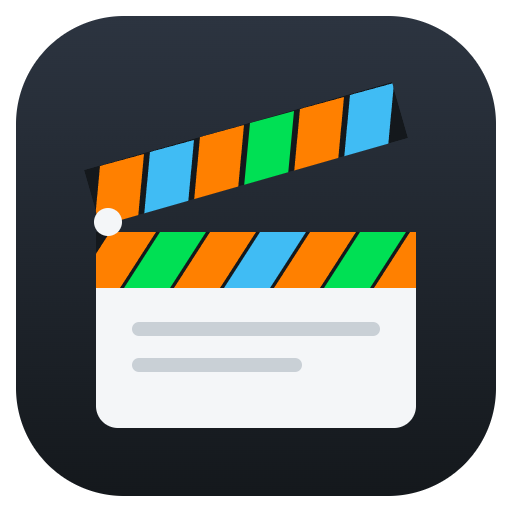

<p align="center">
  
</p>

<h1 align="center">NANDFlix</h1>

<p align="center">
  Sua lista de filmes com cara de streaming: capas, trailers tocando ao fundo, sorteio do que assistir
  e um clique para abrir o filme no <b>Stremio</b> ou registrar no <b>Letterboxd</b>.
</p>

---

O NANDFlix é um app de desktop para catalogar os filmes que você quer ver. Ele troca a planilha por uma interface no estilo Netflix: o filme sorteado ocupa o topo com o trailer rodando, as capas viram trailers ao passar o mouse e cada filme tem uma página de detalhes com logo, notas, sinopse, elenco e duração. Na hora de assistir, ele abre o filme direto no Stremio. Ele também guarda o que você viu num calendário, deixa você dar notas, escrever uma página sobre cada filme, montar tierlists, criar stories para o Instagram e ver as suas estatísticas. Tem também uma **versão para Android**, que pode ficar igual à do computador pela nuvem.

## nandflix, nandchan e nandhub

O app agora tem plataformas, cada uma com a sua lista, o seu tema e o seu vocabulário:

- **nandflix** 🎬: os filmes, como sempre (tema roxo).
- **nandchan** 🍣: os animes (tema laranja).
- **nandhub** 🍿: **tudo junto**, filmes e animes numa lista só.

Ao abrir, o app pergunta onde entrar (dá para marcar **Sempre abrir direto na que eu escolher**); depois, troque pela marca no alto da tela. Em **Configurações → Plataformas** você escolhe o que acompanha e onde o app abre. A estrutura já está pronta para outros tipos no futuro (jogos, séries).

No **nandchan**:

- **Adicionar** busca na [AniList](https://anilist.co) (sem chave); a tela fica em branco até você pesquisar, como a de filmes.
- **Temporadas juntas**: cada série é um item só, com um menu de **temporadas** nos detalhes e a **lista de episódios** com título e sinopse em português (TMDB). Marque episódios, acompanhe o progresso e o status (planejo ver, assistindo, pausado, completo, larguei).
- **Aberturas** de cada temporada (YouTube), **onde assistir** (Crunchyroll, Netflix…) e **Assistir** abrindo direto no Stremio.
- **Em exibição**: quando sai o próximo episódio, selo de episódios novos e a **Agenda**.
- **Watchlist, calendário, estatísticas, tierlists e "anime do mês"** separados dos filmes; no nandhub, tudo junto.
- **Stories**: o story de um anime usa a logo da AniList, estrelas laranja, a capa de uma temporada e um selo de progresso ("Temporada 2 · 10 episódios"). A **retrospectiva em stories** também tem versão de animes.
- **Importar a sua lista da AniList** (Configurações → nandchan), com episódios, status e notas.

`node scripts/testar-anime.js` confere as regras de episódios e a leitura da AniList, sem internet.

## Download

| Arquivo | O que é |
|---|---|
| [`NANDFlix.exe`](NANDFlix.exe) | Versão portátil para Windows: é só abrir, não precisa instalar. |
| [`dist/NANDFlix-Setup-1.1.0.exe`](dist/NANDFlix-Setup-1.1.0.exe) | Instalador para Windows (cria atalho no menu Iniciar). |
| [`dist/NANDFlix-1.1.0-portable.exe`](dist/NANDFlix-1.1.0-portable.exe) | O mesmo portátil da raiz, com o número da versão. |
| [`NANDFlix-Android-1.1.0.apk`](../../releases/latest) | App para Android (na página de Releases). |

Os mesmos arquivos estão na página de [Releases](../../releases).

> O executável não é assinado digitalmente, então o Windows pode mostrar o aviso do SmartScreen na primeira vez. Clique em **Mais informações → Executar assim mesmo**.

## NANDFlix no Android (versão 1.1.0)

A mesma lista no celular, com uma interface feita para o toque, no jeito dos apps de streaming:

- **Início**: a marca no topo, pílulas de filtro (não vistos, vistos, favoritos, gêneros, todos), um cartão de destaque com **Assistir** e **Ver hoje** embaixo da capa, e fileiras de capas para rolar de lado: favoritos, sua lista, suas maiores notas (em tamanho grande), um gênero por fileira, um diretor, para uma noite curta, vistos e adicionados recentemente.
- **Barra de navegação** embaixo: Início, Calendário, Buscar, Tierlist e Mais (páginas, estatísticas, sortear, adicionar, todos os filmes, configurações).
- **Detalhes** em tela cheia: trailer no alto, a logo, ano, classificação e duração, Assistir e Escrever sobre o filme, sinopse e elenco, ícones com nome (story, visto, favorito, hoje, Letterboxd, trailer), sua nota e as abas **Mais do diretor** e **Mais como este**.
- **Calendário** com a grade do mês em capas, a watchlist de hoje, o diário do mês em lista e a página de cada dia; deslizar o dedo troca o mês.
- **Tierlist** numa página só: segure uma capa por um instante e arraste para a tier; a bandeja "Sem tier" fica presa embaixo.
- **Stories e retrospectiva**: **Compartilhar** abre o menu do Android (Instagram, WhatsApp, salvar no aparelho).
- **Importar de outro app** (em Configurações): o `.zip` do Letterboxd (sem descompactar), os `.csv` do IMDb, a biblioteca do Stremio ou um `.csv` de outro lugar.
- **Prêmios** em Mais: as mesmas cédulas do computador (Oscar, Globo de Ouro, Cannes…), numa coluna.
- **Onde assistir**: a pílula **Nos meus serviços** e as fileiras **Nos seus streamings** e **Nos cinemas** no início; a nota do site escolhido no canto das capas.
- **Assistir** sem o app do Stremio instalado: o app avisa e oferece abrir no Stremio Web (ou usar sempre o Stremio Web).
- O botão **Voltar** do Android fecha o que estiver aberto.

**Instalar**: baixe o `.apk` da página de Releases no celular e abra; o Android pede para permitir apps de fora da loja. O app do celular guarda os dados no próprio aparelho; para ter a mesma lista do computador, configure a nuvem (abaixo).

> Planilha e backups em arquivo continuam só no computador.

## Funcionalidades

### Filme sorteado (topo da tela)
- O app já abre com um filme sorteado entre os que você ainda não viu.
- O trailer toca ao fundo, sem som, com botão para ligar o áudio.
- Capa pequena com a **logo do filme** no lugar do título (como na Netflix), gênero, ano, duração e classificação indicativa, notas do IMDb, Metascore e Rotten Tomatoes, sinopse e botões: **Assistir**, **Mais info**, **Sortear outro**, **Marcar como visto** e **Letterboxd**.
- Os sorteios ficam num carrossel: dá para voltar aos anteriores pelas setas ou pelos pontinhos.
- O sorteio respeita o que está na tela: filtro de favoritos, busca e filtro por diretor.
- **Sortear com filtro**: ao passar o mouse no dado do topo, aparece o botão para sortear só entre os filmes de até 1h30, 1h40, 2h ou 2h30, de certos gêneros, décadas ou países, ou só entre os da watchlist de hoje. A janela mostra quantos filmes podem sair, e os filtros ficam salvos. Com filtro ligado, o dado ganha um ponto roxo.
- Clicar no trailer abre o **modo foco**: o vídeo ocupa quase a tela toda, com som e controles, continuando do ponto em que estava.

### Menu do topo
- Ficam sempre à vista a lupa, a seta ▾, **adicionar filme** e **configurações**.
- Passar o mouse na seta abre a lista com ícone e nome: Buscar em tudo, Calendário, Suas páginas, Tierlist, Estatísticas, Prêmios, Sortear e Sortear com filtro. Também abre clicando, e pelo teclado (↑↓ e Esc).

### Busca única (Ctrl + K)
- Uma caixa só que procura nos seus filmes, no texto das suas páginas (com o trecho onde a palavra aparece), no TMDB (só o que ainda não está na lista) e nas ações do app.
- **Enter** abre o resultado; **Shift + Enter** põe o filme na watchlist de hoje ou adiciona o filme do TMDB à lista.
- Na busca normal (lupa), quando nada da lista aparece, surge o botão **Adicionar "o que você buscou"**, que abre a tela de adicionar filme já com a busca feita.

### Prévia ao passar o mouse
- Depois de 1 segundo sobre uma capa, ela cresce e vira o trailer, como na Netflix.
- A prévia traz botões para assistir, marcar visto, favoritar e ver detalhes, além de ano, duração, gêneros e notas. (Letterboxd e remover ficam nos detalhes.)
- Passar pelos botões redondos de cima da capa não dispara o trailer.

### Página de detalhes
- Janela centralizada, com o trailer tocando atrás da capa e do título.
- Logo do filme, ano, duração, classificação indicativa, notas, sinopse, direção, elenco e gêneros.
- **Sua nota**: de ½ a 5 estrelas, dada nos detalhes; aparece também na tierlist e na página do dia do calendário.
- **Outros filmes do diretor** e **Mais como este**: fileiras de capas (com setas nos lados) mostrando o que já está na sua lista e o que você já viu, com **+** para adicionar o que falta.
- Clicar num filme que não está na lista abre os detalhes dele mesmo assim (logo, trailer, sinopse, elenco e os relacionados dele), com **Adicionar à lista** e um botão para voltar ao filme de onde você veio.
- **Remover da lista**, com **Desfazer** no aviso.
- **Pôr numa lista**: marque as suas listas do filme ou crie uma nova digitando o nome.
- Campos editáveis: título, ano, diretor, notas pessoais, link do Letterboxd, busca da capa e link do trailer (para trocar o que foi achado automaticamente).
- A partir do diretor: ver os filmes dele na sua lista ou abrir a página dele no Letterboxd.
- **Trocar capa**: escolher outra capa do mesmo filme no TMDB, buscar o filme certo (se o achado foi outro) ou usar uma imagem sua (também dá para arrastar a imagem para cima da capa).

### Listas
- **Filmes na sua lista**: fileira com os favoritos, rolagem suave pelas setas, trackpad ou Shift + roda do mouse, e a contagem de quantos você já viu.
- **Todos os filmes**: grade de capas ou lista compacta, filtros (todos, não vistos, vistos, favoritos), ordenação (ordem original, título, ano, diretor, país, adicionados recentemente) e o progresso de vistos.
- **Agrupar por diretor ou por país**: ordenando por um deles, a lista se separa em grupos com o nome e a quantidade de filmes (ex.: "Brasil · 6 filmes"). Cada filme entra no grupo do seu país principal; os países aparecem em português.
- **Filtrar por diretor ou país**: clicando no nome do grupo, ou no diretor e nos países da página de detalhes. Uma etiqueta mostra o filtro ativo e tira o filtro com um clique.
- Busca por título, ano, diretor, país ou notas, sem diferenciar acentos.
- **Listas suas** (ex.: "Ciclo Kurosawa", "Rever"): o botão **Listas ▾** filtra a tela por uma delas, e cada lista pode ser renomeada ou apagada (com desfazer). As listas também servem de filtro no sorteio e na tierlist.

### Páginas: o seu texto sobre cada filme
- Um editor simples, com títulos, negrito, itálico, sublinhado, riscado, citação, listas e divisor, que salva sozinho enquanto você escreve. Atalhos como `# `, `> `, `- ` e `1. ` no começo da linha viram título, citação e listas.
- **Imagens**: cole (Ctrl + V), arraste ou use o botão **Colar a imagem copiada** da barra, que puxa a imagem da área de transferência sem precisar de Ctrl + V (vale também para um arquivo de imagem copiado no Explorer).
- **Shots favoritos**: até duas cenas no topo da página, à direita. Com duas, uma fica atrás da outra.
- Clicar em qualquer imagem abre o **visualizador**: setas para passar de uma para outra, clique para ampliar e, nos shots, **Pôr na frente** para trocar a ordem.
- No calendário, o dia em que o filme foi visto mostra um trecho da página como uma resenha em destaque. **Suas páginas**, no menu do topo, reúne tudo o que você escreveu, separado por mês.

### Story para o Instagram
- Nos detalhes de um filme visto (ou pela página dele), **Criar story** monta uma imagem 1080×1920: a capa no centro, as estrelas da sua nota e a logo do Letterboxd.
- Fundo da capa desfocada, degradê com as cores da capa ou preto, e **Trocar capa** por outra do TMDB (só no story).
- Arraste os elementos (com guia de centro), mude o tamanho pela roda do mouse e clique num espaço vazio para escrever uma caixa de texto. Trechos da sua página viram texto com um clique.
- **Salvar imagem** (Ctrl + S) ou **Copiar** (Ctrl + C). O story de cada filme fica guardado.

### Calendário
Um diário dos filmes que você vê e um planejador do que vai ver, aberto pelo botão de calendário no topo, ao lado da busca.

- **O que você viu, dia a dia**: o mês atual abre com o dia de hoje destacado, e cada dia em que você viu um filme vira um pequeno pôster, com as capas por cima da capa desfocada. As setas trocam de mês (com uma transição deslizando de um mês para o outro).
- Marcar um filme como visto já registra o dia. Para rever, use **Vi de novo hoje** nos detalhes: o filme aparece em todos os dias em que foi visto. Esqueceu de marcar? **Lançar outro dia** escolhe a data, e cada data pode ser apagada.
- **Pensando em ver hoje**: separe os filmes que você está considerando pelo botão de calendário na capa, na prévia ou nos detalhes. Eles ganham um selo roxo e aparecem no dia de hoje; ao marcar um como visto, ele passa para os vistos do dia. A watchlist é do dia: quando o dia vira, ela some.
- **Sortear um filme**: na página de hoje, o fundo escurece e as capas giram no centro da tela até parar num filme não visto, com logo, ano, duração, gêneros e sinopse. Aí você escolhe **Colocar na watchlist**, **Sortear de novo** (com o menu ▾ para sortear sem filtro ou escolher filtros) ou **Agora não**.
- **Página do dia**: clique num dia para ver as capas grandes, com os vistos centralizados e a watchlist com Assistir, marcar visto ou tirar da lista.
- **Planeje arrastando**: arraste a capa de um filme da watchlist para outro dia. Hoje ou depois, ele vai para a watchlist daquele dia; antes de hoje, fica registrado como visto nele. Segure sobre as setas ‹ › para trocar de mês sem soltar. Sem arrastar: **Passar para amanhã** e **Trazer para hoje** na página do dia.
- **Filme do mês**: escolha o seu favorito entre os filmes vistos em cada mês, pelo botão dourado no topo do mês ou por **Marcar como filme do mês** na página do dia. Ele aparece no topo com um troféu, e a capa dele vai para a frente no dia em que foi visto, com aro dourado.
- **Sortear com filtro** na página de hoje: a roleta de capas só com os filmes que passam nos filtros do sorteio, entre os que estão fora da watchlist (o escolhido entra nela) ou entre os que já estão nela (o escolhido vai para o primeiro lugar).
- Na página de um dia, a watchlist mostra cinco filmes por linha, e **arrastar uma capa muda a ordem** deles.
- Na página de um dia, os filmes vistos mostram a sua nota.
- O calendário começa no mês do filme visto mais antigo (inclusive as datas importadas do Letterboxd).
- O dia vira às 5h da manhã: um filme visto de madrugada conta para a noite anterior.
- Respeita o "reduzir movimento" do sistema: com os efeitos de animação desligados no Windows, o calendário não anima.

### Tierlist
Uma tierlist dos filmes que você já viu, aberta pelo botão de medalha ao lado do calendário.

- **Várias tierlists**: o título abre o menu para trocar de tierlist, criar uma nova, renomear (ex.: "Terror", "Melhores de 2026") ou apagar.
- **Filtros** por gênero, diretor, país, década e mês em que você viu, salvos em cada tierlist. Reorganizar os filmes visíveis não mexe na posição dos que o filtro esconde.
- Começa com as tiers **S, A, B, C, D e F**; os filmes vistos que ainda não estão em nenhuma ficam na bandeja **Sem tier**, embaixo, com um campo para filtrar.
- A ordem da tierlist decide o ranking da **retrospectiva**: as tiers mais altas vêm primeiro.
- **Arraste as capas** para as tiers, entre elas ou de volta para a bandeja. As outras capas abrem espaço deslizando, e a ordem dentro de cada tier fica salva.
- **Clique no nome** de uma tier para renomeá-la; a fonte diminui sozinha para nomes longos caberem.
- **Arraste pela alça ⋮⋮** (ou pelo rótulo) para mudar a tier de posição.
- Cada tier tem uma **paleta de cores** (ou qualquer cor pelo seletor do sistema) e pode ser apagada, com opção de desfazer. **Nova tier** cria quantas você quiser.
- As tiers dividem a altura da janela, então as seis padrão aparecem inteiras; com muitas tiers, a lista passa a rolar.
- A sua nota aparece num selo embaixo de cada capa (a nota não decide a tier: as duas coisas são separadas).

### Estatísticas
Aberta pelo botão de gráfico no topo, para todo o período ou para cada ano.

- **Retrospectiva**: uma frase com quantos filmes e horas você viu, o diretor, o país e o gênero do período.
- Filmes vistos (e sessões, contando as revisões), horas de filme, dias com filme, a maior sequência de dias seguidos, a sua nota média e os revistos.
- Filmes por mês, diretores e países mais vistos (clicar filtra a lista), gêneros, décadas e a distribuição das suas notas.
- As suas maiores notas, os filmes do mês e os que você mais reviu.
- Num ano, uma linha com os meses deixa ver as estatísticas de um mês só.

### Retrospectiva em stories (mês ou ano)
Nas Estatísticas, **Criar stories da retrospectiva** gera imagens 1080×1920 prontas para postar:

1. **Capa**: "Meu outubro em filmes", com o total, as horas e três capas em leque.
2. **Meu top 5**: o ranking do período, com as estrelas e a etiqueta da tier de cada filme.
3. **Tierlist**: as tiers com as capas dos filmes vistos no período. Em **Ajustar** você escolhe o título, qual tierlist usar, quais tiers aparecem e se entram só os vistos no período ou todos da tierlist.
4. **Os números** do período.
5. **Filme do mês**, ou, no ano, os filmes de cada mês.
6. **Mosaico** de tudo o que você viu.
7. **Resumão**, no estilo do Spotify Wrapped: top filmes, top diretores, filmes vistos, horas, gênero do período e nota média.

O ranking segue a tierlist: primeiro os filmes das tiers mais altas, na ordem de dentro de cada tier, depois os sem tier, pela sua nota. Na retrospectiva de um mês, o filme do mês é sempre o nº 1. Cada imagem tem **Copiar** e **Salvar**, e **Salvar todas** grava todas numa pasta.

### Prêmios: as cédulas do Oscar, do Globo de Ouro, de Cannes…
Aberta pelo menu do topo (**Prêmios**), pela busca (Ctrl + K) ou, no celular, por **Mais**.

- A **lista de prêmios** no alto: **Oscar**, **Globo de Ouro**, **Critics Choice**, **BAFTA**, **Actor Awards (SAG)**, **Independent Spirit**, **Gotham** e os festivais de **Cannes**, **Veneza** e **Berlim**. Embaixo, uma **aba por ano**. Abre na edição mais recente com indicados; a próxima aparece como "em breve" até os indicados saírem.
- Só as categorias de cinema (as de TV do Globo de Ouro, do Critics Choice e do SAG ficam de fora).
- Nos festivais, cada prêmio do júri (Palma de Ouro, Grande Prêmio, Direção, Atuação…) é uma categoria com todos os filmes da competição: dá para palpitar antes do júri, e o premiado fica dourado depois.
- Em cada categoria, os indicados com capa, filme e pessoa (diretor, atores, canção). **Visto** vem marcado sozinho para os filmes que você já viu; marcar um filme que não está na lista o adiciona como visto (sem data: dá para pôr no calendário depois, em "Lançar outro dia"). **Palpite** é o seu voto em quem vence a categoria.
- No alto, quantos dos filmes indicados você viu, quantos palpites fez e, depois da cerimônia, quantos acertou (cada categoria mostra **Acertou** ou **Errou**, e o vencedor fica dourado). **Só o que falta ver** esconde os que você já viu.
- Os dados vêm das páginas das cerimônias na Wikipédia, que são atualizadas minutos depois de cada anúncio: o app busca as edições recentes sozinho (a cada 3 horas na temporada de cada prêmio, uma vez por dia no resto do ano). O histórico já vem dentro do app. As cédulas vão para a nuvem.
- Os prêmios também são **filtros**: em **Filtros** na barra da lista (indicados, vencedores ou uma categoria, como "venceu Melhor Filme"), nos filtros do sorteio e nos da tierlist. Nos detalhes do filme aparece, por exemplo, "Oscar: 6 vitórias · 13 indicações" ou "Cannes: Palma de Ouro", com cada categoria; o ano abre a cédula daquela edição.

### Onde assistir
- Nos detalhes, os streamings em que o filme está no seu país (por assinatura, grátis, aluguel e compra), com os logos; **Nos cinemas** quando ele estreou há pouco e ainda não saiu em digital (ou a data, se estreia nos próximos 30 dias); e **No Stremio** quando ele está no catálogo do Stremio (se dá para assistir depende dos complementos do seu Stremio).
- Em **Configurações → Onde assistir**: o país e os streamings que você assina. Os seus aparecem primeiro e destacados, e viram filtro: **Filtros → Nos meus serviços** na lista, e a seção **Onde assistir** nos filtros do sorteio.
- Os streamings vêm do JustWatch, pelo TMDB. Tudo é atualizado sozinho a cada 7 dias.

### Notas de cada site
- Nos detalhes, no destaque e na prévia, um selo para cada site: **IMDb**, **Letterboxd**, **Metascore**, **Rotten Tomatoes** e **TMDB**. Clicar abre a página do filme no site.
- Uma nota no canto de cada capa, do site que você escolher em **Configurações → Nota nas capas** (ou nenhuma). **Ordenar por: Nota** usa o mesmo site.
- Letterboxd e TMDB não precisam de chave e são atualizados a cada 7 dias; IMDb, Metascore e Rotten Tomatoes vêm do OMDb (chave opcional).

### Importar de outro app
Em **Configurações → Importar de outro app** (ou pela busca, Ctrl + K), escolha de onde:

- **Letterboxd**: o `.zip` do export de dados (*Settings → Import & Export → Export your data*), sem descompactar. Vêm os vistos com as datas do diário (inclusive as revisões), as notas e a watchlist.
- **IMDb**: os `.csv` de **Suas avaliações** e da **Watchlist** (no IMDb, menu … → Exportar; os arquivos ficam em imdb.com/exports). As avaliações viram vistos com nota (de 1 a 10 vira de ½ a 5 estrelas); séries ficam de fora.
- **Stremio**: entre com a conta do Stremio. Os filmes assistidos (ou marcados como vistos) viram vistos, e o resto da biblioteca entra como watchlist. A senha vai só para o Stremio e não fica guardada.
- **Rotten Tomatoes e outros**: o Rotten Tomatoes não exporta as avaliações; use uma extensão que gere um `.csv` no formato de importação do Letterboxd. Serve qualquer `.csv` com título e ano (e, se tiver, nota em qualquer escala, data em que viu, código do IMDb ou uma coluna de watchlist).

Em todos: os vistos são marcados, e só entram as datas de antes do primeiro dia já registrado no NANDFlix (para não repetir o calendário); as notas preenchem "Sua nota" onde ela está vazia; a watchlist entra como filmes novos; filmes que não estão na lista são procurados no TMDB antes, para não duplicar. Nada é apagado, e um backup é feito antes. Depois, a lista mostra tudo (sem filtros), para os filmes novos aparecerem.

### Stremio e Letterboxd
- **Assistir** abre o filme no app do Stremio e traz a janela para a frente. Também dá para usar o Stremio Web. Sem o app instalado (no computador ou no celular), o NANDFlix avisa e oferece abrir no Stremio Web.
- **Letterboxd** abre a página do filme para registrar que você viu.

### Capas, trailers e informações
- Capas, logos, trailers, sinopse (em português), gêneros, elenco, direção, duração, países e classificação indicativa vêm do [TMDB](https://www.themoviedb.org/), que não tem limite diário. A capa é sempre a do idioma original do filme. Capas e logos ficam salvas no computador e funcionam sem internet.
- Tudo é buscado em segundo plano ao abrir o app (4 filmes por vez), com uma barra de progresso no topo. Filmes novos ganham capa e informações logo depois de adicionados.
- O trailer é o oficial do filme no YouTube; sem um, o app procura no YouTube pelo título e ano. Um trailer colado à mão nunca é trocado.
- **Opcional**: com uma chave do [OMDb](https://www.omdbapi.com/), os filmes mostram também as notas do IMDb, Metascore e Rotten Tomatoes.

### Nuvem: a mesma lista no computador e no celular
Com uma conta, o NANDFlix sincroniza filmes, notas, datas vistas, páginas (com as imagens), stories, listas, watchlists, tierlists, filmes do mês e as chaves das APIs entre os aparelhos, pelo [Supabase](https://supabase.com) (gratuito).

- **Tela de entrada**: com a nuvem configurada, o app abre pedindo para **entrar** ou **criar conta** (e-mail e senha); o login fica guardado. Dá para continuar sem conta.
- Cada mudança sobe em alguns segundos e chega aos outros aparelhos na hora. Sem internet, tudo funciona e sincroniza depois.
- Mudanças em campos diferentes do mesmo filme, feitas em aparelhos diferentes, ficam as duas; no mesmo campo, vence a mais nova. Um filme apagado não volta.
- Se a mesma página for editada em dois aparelhos antes de sincronizar, fica a mais nova e a outra versão aparece num aviso para você escolher.
- Em **Configurações → Nuvem**: a conta, quando foi a última sincronia, **Sincronizar agora** e **Sair da conta**.

A versão do GitHub vem sem projeto de nuvem: cada pessoa cria o seu (veja [Configurar a nuvem](#configurar-a-nuvem-opcional)).

### Planilha e backups
- Importa a lista de uma planilha `.xlsx`, substituindo a atual ou juntando as duas (filmes repetidos são reconhecidos).
- Exporta a lista para `.xlsx`.
- Faz um backup a cada abertura (guarda os 5 últimos) e permite exportar e importar backups (com watchlists, tierlists e listas).
- **Backup diário**: uma cópia por dia com filmes, notas, páginas, stories, watchlists, tierlists e listas (sem as chaves das APIs), refeita a cada hora em que algo mudou e ao fechar o app. Ficam os 30 dias mais recentes. Em **Configurações → Backup automático** dá para mandar a mesma cópia para outra pasta (como a do Google Drive) e **restaurar um dia**; o estado de antes é guardado, então dá para voltar atrás.

### Atalhos

| Atalho | Ação |
|---|---|
| `Ctrl + F` | Pesquisar |
| `Ctrl + K` | Buscar em tudo |
| `Ctrl + N` | Adicionar filme |
| `R` | Sortear |
| `Esc` | Fechar janela, prévia ou pesquisa |

## Primeiro uso

1. Abra o `NANDFlix.exe`.
2. Cole a sua chave do TMDB na tela que aparece (veja abaixo como conseguir uma).
3. Clique em **Importar planilha** e escolha o seu `.xlsx`, ou adicione filmes pelo **+**.
4. As capas começam a ser buscadas sozinhas.

## Como conseguir a sua chave do TMDB

As capas, logos, trailers e informações vêm do [TMDB](https://www.themoviedb.org/), que pede uma chave por pessoa. Ela é gratuita e não tem limite diário. O app só usa a chave: nunca pede a sua senha.

1. Crie uma conta grátis em [themoviedb.org/signup](https://www.themoviedb.org/signup) e confirme pelo e-mail.
2. Abra [themoviedb.org/settings/api](https://www.themoviedb.org/settings/api) e peça uma chave (**Developer**). No formulário, o uso pode ser algo como "app pessoal de catálogo de filmes".
3. Copie a **Chave da API** (32 letras e números) e cole na tela **Chave do TMDB** do NANDFlix.

Enquanto não houver chave salva, essa tela aparece toda vez que o app abre; dá para fechar em **Agora não** e usar o app sem capas novas. A chave pode ser trocada depois em **Configurações**, e o app confere se ela funciona antes de salvar.

### Notas do IMDb, Metascore e Rotten Tomatoes (opcional)
Essas três notas vêm do [OMDb](https://www.omdbapi.com/). Para vê-las, pegue uma chave gratuita em [omdbapi.com/apikey.aspx](https://www.omdbapi.com/apikey.aspx) (plano **FREE**, 1.000 consultas por dia; clique no link de ativação do e-mail) e cole em **Configurações → OMDb**. Sem ela, o app funciona igual, só sem essas notas.

> Este app usa a API do TMDB, mas não é endossado nem certificado pelo TMDB.

## Configurar a nuvem (opcional)

1. Crie uma conta em [supabase.com](https://supabase.com) e um projeto.
2. No **SQL Editor** do projeto, rode o conteúdo de [`supabase/esquema.sql`](supabase/esquema.sql) (a tabela da sincronia, só com acesso de cada um aos próprios dados, e a pasta das imagens).
3. Em **Project Settings → API**, copie a **Project URL** e a chave **publishable** (nunca a `service_role`/secret) e crie o arquivo `lib/nuvem.config.json`:

   ```json
   { "url": "https://SEU-PROJETO.supabase.co", "chave": "sb_publishable_..." }
   ```
4. Gere o app (`npm run build`) e, para o celular, o APK (veja [Android](#android)). O arquivo de configuração vai junto e não entra no repositório (`.gitignore`).

Opcional: rodando [`supabase/atualizacoes.sql`](supabase/atualizacoes.sql) (com o seu e-mail no lugar do exemplo), o app do celular passa a **se atualizar sozinho**: o `npm run montar` gera o pacote da interface, o app do computador, logado, publica, e o celular baixa e troca na próxima abertura, sem instalar outro APK.

## Atualização automática
O app procura versão nova nas [Releases](../../releases) ao abrir e a cada 6 horas.
- **Instalado pelo Setup**: baixa sozinho em segundo plano e avisa quando estiver pronto (**Reiniciar e atualizar**); fechar o app também instala.
- **Portátil**: o `.exe` não consegue se trocar sozinho, então o app só avisa que saiu uma versão nova, com o link para baixar.

## Onde ficam os dados

Tudo fica no seu computador, em `%APPDATA%\Filmes legais` (Windows):

- `filmes.json`: a lista, salva a cada mudança.
- `capas/`: as imagens baixadas.
- `backups/`: os 5 últimos backups e os backups diários dos últimos 30 dias.
- `sincronia.json` e `nuvem.json`: quando cada dado mudou e o estado da sincronia com a nuvem (o login fica cifrado em `nuvem-sessao.bin`).
- `imagens/`: as imagens coladas nas páginas e os shots favoritos.
- `config.json`: as suas chaves do TMDB e do OMDb, preferências, watchlists, tierlist, filmes do mês, filtros do sorteio e posição da janela.

**Configurações → Abrir pasta de dados** leva direto a ela.

## Desenvolvimento

Precisa do [Node.js](https://nodejs.org) (versão LTS).

```bash
npm install        # instala as dependências
npm start          # abre o app em modo de desenvolvimento
npm run build      # gera o portátil e o instalador em dist/
npm run import -- "minha-lista.xlsx"   # importa uma planilha pela linha de comando
npm run premios    # refaz lib/premios-<prêmio>.json (o histórico de cada prêmio) pela Wikipédia
npm run premios -- oscar cannes   # só alguns prêmios
```

Para importar pela linha de comando com filmes já salvos, acrescente `--substituir` ou `--juntar` (com o app fechado).

### Android

Precisa de um JDK 21 e do Android SDK (plataforma 36), com `JAVA_HOME` e `ANDROID_HOME` apontando para eles.

```bash
cd mobile
npm install
npm run testar     # abre o app do celular numa janela do tamanho de um Android, no PC
npm run apk        # monta a interface, sincroniza com o projeto Android e gera o APK de teste
```

O `npm run montar` junta a interface de `src/` com a ponte do celular (`mobile/api/`, que guarda os dados no aparelho e reaproveita `lib/`) e os ajustes de celular (`mobile/web/`), em `mobile/www`.

O `build` foi testado no Windows. A configuração para Mac (`.dmg`) e Linux (`.AppImage`) existe, mas cada sistema precisa gerar o próprio executável.

### Estrutura

```
NANDFlix/
├── NANDFlix.exe        versão portátil pronta
├── dist/               executáveis gerados pelo build
├── main.js             processo principal do Electron: janela, dados, capas, trailers, Stremio
├── preload.js          ponte segura entre a interface e o processo principal
├── lib/
│   ├── armazem.js      leitura e gravação dos dados e backups
│   ├── extras.js       notas do Letterboxd e do TMDB, onde assistir, cinemas e Stremio
│   ├── premios.js      indicados e vencedores dos prêmios (Wikipédia e Wikidata)
│   ├── premios-*.json  o histórico de cada prêmio (npm run premios)
│   ├── importar.js     importar de outros apps (Letterboxd, IMDb, CSV)
│   ├── stremio.js      a biblioteca do Stremio de uma conta
│   ├── marcas.js       quando cada dado mudou (para a sincronia)
│   ├── nuvem.js        login e sincronia com o Supabase
│   ├── filmes.js       modelo do filme, repetidos e junção de listas
│   ├── letterboxd.js   leitura do export de dados do Letterboxd
│   ├── omdb.js         notas do IMDb, Metascore e Rotten Tomatoes (opcional)
│   ├── planilha.js     importação e exportação de .xlsx
│   ├── tmdb.js         capas, logos, trailers, informações, filmografia e recomendações
│   └── trailer.js      busca do trailer no YouTube (quando o TMDB não tem)
├── src/                interface (HTML, CSS e JavaScript puros)
│   ├── app.js          tela principal, detalhes, calendário, tierlist e estatísticas
│   ├── entrada.js      tela de entrar ou criar conta
│   ├── pagina.js       páginas, imagens, shots favoritos e visualizador
│   ├── story.js        editor de story
│   ├── retro.js        retrospectiva em stories
│   ├── listas.js       listas suas
│   ├── onde.js         onde assistir e o menu Filtros
│   ├── premios.js      prêmios: as cédulas e os filtros por prêmio
│   └── busca.js        busca única (Ctrl + K)
├── mobile/             app de Android (Capacitor)
│   ├── api/            a ponte do celular: dados no aparelho, nuvem, TMDB
│   ├── web/            a interface de celular por cima da do PC
│   ├── android/        projeto Android
│   └── montar.js       monta mobile/www
├── supabase/           SQL do banco da nuvem e das atualizações do celular
├── scripts/            importação pela linha de comando e o histórico dos prêmios
└── build/              ícone do app
```

### Tecnologias

- [Electron](https://www.electronjs.org/), com HTML, CSS e JavaScript puros, sem framework.
- [SheetJS](https://sheetjs.com/) para as planilhas e [Lucide](https://lucide.dev/) para os ícones.
- APIs: TMDB (capas, logos, trailers, informações e, pelo JustWatch, onde assistir), OMDb (notas, opcional), YouTube (trailers, pelo player sem cookies), Letterboxd (a média de cada filme, da página pública), Cinemeta (o catálogo do Stremio) e Wikipédia com Wikidata (indicados e vencedores dos prêmios) e a API do Stremio (importar a biblioteca).
- [electron-updater](https://www.electron.build/auto-update) para a atualização automática pelas releases do GitHub.
- [Supabase](https://supabase.com) para a nuvem e [Capacitor](https://capacitorjs.com) para o app de Android (com o [Capgo Updater](https://github.com/Cap-go/capacitor-updater) para se atualizar sem reinstalar).
- Fonte [Montserrat](https://fonts.google.com/specimen/Montserrat) (licença OFL), pelo pacote `@fontsource/montserrat`.
